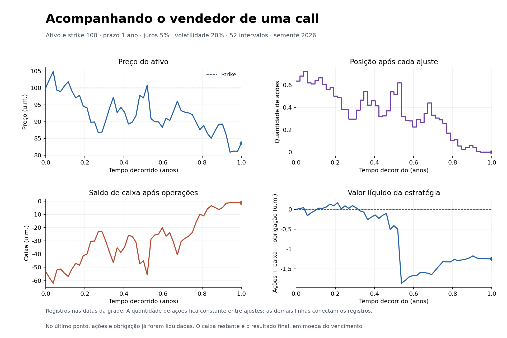
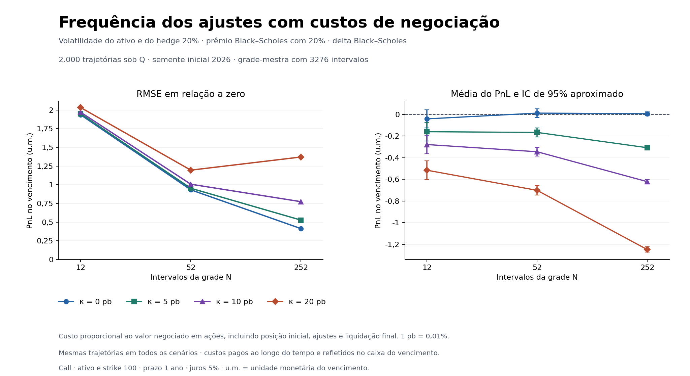

# Options Lab

Estudo em Python sobre precificação de opções europeias e o resultado financeiro de um delta hedge discreto. O projeto reúne Black–Scholes, árvore binomial de Cox–Ross–Rubinstein, Monte Carlo, sensibilidades e uma simulação contábil do vendedor de uma call.

O [notebook principal](notebooks/options_lab.ipynb) apresenta as hipóteses, desenvolve as fórmulas e interpreta os experimentos. Os cálculos reutilizáveis ficam no pacote `options_lab`; as figuras e os resultados numéricos podem ser reproduzidos pelos scripts.

Versão 1.0.0. Requer Python 3.10 ou posterior.

## Executar

Na pasta do projeto, com um ambiente virtual ativo, instale o pacote e abra o notebook.

```bash
python -m pip install -e ".[notebook]"
python -m jupyterlab notebooks/options_lab.ipynb
```

Os módulos de cálculo e os testes usam a biblioteca padrão do Python. O extra `notebook` instala JupyterLab, o kernel Python e Matplotlib. Para usar apenas a API, basta `python -m pip install -e .`.

Execute a suíte de testes com

```bash
python -m unittest discover -s tests -v
```

O notebook pode ser executado e validado automaticamente, com todas as saídas recalculadas:

```bash
python -m pip install -e ".[plots,validation]"
python scripts/validate_notebook.py
```

O script usa um kernel do mesmo ambiente Python. A opção `--in-process` executa as células em IPython, sem iniciar um kernel externo, e `--html arquivo.html` exporta a versão executada para leitura no navegador.

Para gerar todas as figuras e os relatórios JSON, execute

```bash
python scripts/plot_greeks.py
python scripts/plot_crr_tree.py
python scripts/plot_crr_convergence.py
python scripts/plot_monte_carlo.py
python scripts/plot_delta_hedge.py
python scripts/plot_hedging_experiments.py
```

O extra `plots` também permite executar os scripts sem instalar JupyterLab.

```bash
python -m pip install -e ".[plots]"
```

As comparações de hedge usam 2.000 trajetórias por padrão. O relatório guarda as amostras, os parâmetros, as sementes, a versão do pacote e a versão do Python. Para redesenhar essas comparações a partir dos resultados já salvos, execute

```bash
python scripts/plot_hedging_experiments.py --from-json reports/hedging_experiments_results.json
```

## Modelo e métodos

Cada opção se refere a uma unidade de um ativo sem dividendos, tem exercício europeu e liquidação financeira. Os payoffs são $\max(S_T-K,0)$ para a call e $\max(K-S_T,0)$ para a put. O tempo é medido em anos, e juros e volatilidade são expressos em decimal.

Sob a medida neutra ao risco $\mathbb Q$, o ativo segue

$$
\mathrm{d}S_t=rS_t\mathrm{d}t+\sigma S_t\mathrm{d}W_t^{\mathbb{Q}},
\qquad
V_t=e^{-r(T-t)}\mathbb{E}^{\mathbb{Q}}[h(S_T)\mid\mathcal{F}_t].
$$

Os juros e a volatilidade são constantes. A conta de caixa rende à taxa contínua $r$, inclusive quando seu saldo é negativo. Posições fracionárias e empréstimos à mesma taxa das aplicações são permitidos.

- **Black–Scholes** fornece os preços analíticos de calls e puts e as sensibilidades delta, gamma e vega. Vega representa a derivada em relação à volatilidade decimal; multiplicá-lo por `0.01` converte a sensibilidade para um ponto percentual.
- **Árvore CRR** calcula o preço por indução retroativa. O número de intervalos deve satisfazer a condição de ausência de arbitragem da malha. A comparação acompanha a convergência para Black–Scholes.
- **Monte Carlo** sorteia a distribuição terminal exata e calcula a média dos payoffs descontados, seu erro padrão e um intervalo normal aproximado de 95%.
- **Trajetórias e hedge** usam transições exatas do movimento browniano geométrico nas datas de uma grade uniforme. A posição em ações é ajustada somente nessas datas.

No caso-base, $S_0=K=100$, $T=1$, $r=0{,}05$ e $\sigma=0{,}20$. Os preços estão em unidades monetárias, abreviadas por u.m.

| Método | Call | Put |
|---|---:|---:|
| Black–Scholes | 10,450584 | 5,573526 |
| CRR com 1.000 intervalos | 10,448584 | 5,571526 |
| Monte Carlo com 1.000.000 de amostras | 10,469055 | 5,561110 |

O Monte Carlo da tabela usa `seed=2026` e Python 3.12.14. Os erros padrão são aproximadamente 0,014721 u.m. para a call e 0,008643 u.m. para a put. As estimativas e os intervalos completos estão no [relatório de precificação](reports/monte_carlo_results.json).

## Usar a API

```python
from options_lab import (
    black_scholes_price,
    black_scholes_greeks,
    simulate_gbm_path,
    delta_hedge_path,
)

price = black_scholes_price(100, 100, 1, 0.05, 0.20, option_type="call")
greeks = black_scholes_greeks(100, 100, 1, 0.05, 0.20, option_type="call")
path = simulate_gbm_path(100, 1, 0.05, 0.20, steps=52, seed=2026)
hedge = delta_hedge_path(
    path, 100, 1, 0.05, 0.20,
    initial_premium=price,
    transaction_cost_rate=0.001,
)

print(price, greeks.delta)
print(hedge.terminal_pnl)
print(hedge.total_transaction_cost, hedge.terminal_transaction_cost)
```

A API pública inclui `european_payoff`, `binomial_crr_price`, `monte_carlo_price` e `run_hedging_experiments`. Os resultados de sensibilidades, Monte Carlo e hedge são dataclasses imutáveis.

Preços devem ser positivos e todas as entradas numéricas devem ser finitas. A precificação aceita prazo ou volatilidade zero. As sensibilidades e o hedge exigem ambos estritamente positivos. A simulação de trajetórias exige prazo positivo e aceita volatilidade zero. Juros negativos são aceitos. Tipos inválidos geram `TypeError`, valores fora do domínio geram `ValueError` e cálculos fora do alcance de `float` geram `OverflowError`.

## Contabilidade do hedge

O vendedor recebe o prêmio $P_0$, compra $\Delta_0$ ações e financia a diferença pelo caixa. Para uma negociação de $q_i$ ações ao preço $S_i$, o custo proporcional é $c_i=\kappa|q_i|S_i$, em que $\kappa$ é a taxa `transaction_cost_rate`. Esse custo incide na montagem, nos ajustes e na liquidação.

$$
A_0=P_0-\Delta_0S_0-c_0,
\qquad
A_i=A_{i-1}e^{r\Delta t}-(\Delta_i-\Delta_{i-1})S_i-c_i.
$$

A segunda expressão vale nas datas interiores. Todos os ajustes são pagos pelo caixa da própria estratégia. No vencimento, as ações são vendidas e o payoff é pago ao comprador.

$$
\mathrm{PnL}_T
=A_{N-1}e^{r\Delta t}+\Delta_{N-1}S_T-h(S_T)-c_N.
$$

`HedgeResult.records` contém um registro por data, sempre após as operações. Cada registro guarda preço, ações, negociação, juros, fluxo da opção, custo, caixa, valor da obrigação, valor da carteira e valor líquido. No último registro, ações e obrigação estão encerradas, e o caixa coincide com `terminal_pnl`.

`total_transaction_cost` soma os custos nominais. `terminal_transaction_cost` leva cada pagamento à data de vencimento, calculando $\sum_i c_i e^{r(T-t_i)}$. Mantidos trajetória, grade, delta e prêmio, o PnL com custos é o PnL sem custos menos essa soma acumulada.

O padrão `transaction_cost_rate=0.0` permite analisar a replicação sem despesas. O prêmio padrão é Black–Scholes com a volatilidade fornecida ao hedge. Para definir outro prêmio recebido, use `initial_premium`. O delta e a marcação da obrigação seguem Black–Scholes para a volatilidade do hedge.



## Frequência, custos e risco

Os experimentos usam 2.000 trajetórias sob $\mathbb Q$, parâmetros do caso-base e sementes `2026 + i`. Cada trajetória é gerada em uma grade de 3.276 intervalos. As grades de 12, 52 e 252 intervalos são subamostras dessa trajetória, compartilhando preços nos mesmos instantes e o mesmo valor terminal.

São comparadas quatro taxas de custo, $\kappa\in\lbrace 0;0{,}0005;0{,}001;0{,}002\rbrace$, com a volatilidade correta e prêmio inicial de 10,450584 u.m. A tabela destaca os cenários sem custos e com custo de 0,2% do valor negociado.

| Intervalos | Custo por negociação | Média do PnL | Desvio-padrão | RMSE |
|---:|---:|---:|---:|---:|
| 12 | 0% | −0,041602 | 1,935844 | 1,935807 |
| 52 | 0% | 0,011389 | 0,932139 | 0,931975 |
| 252 | 0% | 0,005652 | 0,412408 | 0,412344 |
| 12 | 0,2% | −0,515691 | 1,966756 | 2,032765 |
| 52 | 0,2% | −0,701431 | 0,968001 | 1,195224 |
| 252 | 0,2% | −1,248070 | 0,567931 | 1,371154 |

O desvio-padrão mede a dispersão dos resultados. O RMSE é $\sqrt{M^{-1}\sum_{j=1}^M\mathrm{PnL}_{T,j}^2}$ e também incorpora o afastamento da média em relação a zero. O erro padrão da média, usado nos intervalos de confiança, mede a incerteza amostral dessa média.

Sem custos, aumentar a frequência reduz a dispersão nesta amostra. Com custo de 0,2%, a grade de 52 intervalos apresenta menor RMSE que a de 252, pois negociar mais frequentemente também aumenta as despesas. A escolha de frequência depende dos custos, da medida de risco e das hipóteses adotadas.



## Volatilidade usada no delta e no prêmio

O ativo é simulado com volatilidade de 20%. O hedge usa 15%, 20% ou 25%, sempre com 252 intervalos e custo zero. Para cada regra de hedge, comparamos receber o prêmio fixo de Black–Scholes com 20% e receber o prêmio calculado com a volatilidade usada no delta.

| Volatilidade do hedge | Média com prêmio fixo | Desvio-padrão | Prêmio com a volatilidade do hedge | Média com esse prêmio |
|---:|---:|---:|---:|---:|
| 15% | 0,036293 | 0,952730 | 8,591658 | −1,917941 |
| 20% | 0,005652 | 0,412408 | 10,450584 | 0,005652 |
| 25% | −0,014593 | 0,796646 | 12,335999 | 1,967490 |

Com o prêmio fixo correto, a esperança do PnL sob $\mathbb Q$ é zero para as três regras. O ativo descontado é um martingal e as quantidades de ações são escolhidas com a informação já disponível. A volatilidade incorreta altera a dispersão do resultado; os intervalos de 95% das três médias amostrais contêm zero.

Mudar somente o prêmio desloca cada resultado por $(P_h-P_{\mathrm{true}})e^{rT}$. Assim, ao receber o prêmio calculado com a volatilidade do hedge, a média teórica passa a ser essa diferença financiada. O desvio-padrão permanece igual ao do cenário de prêmio fixo. O lucro médio observado com 25% inclui o prêmio maior recebido no início.

A marcação `option_value` usa a volatilidade do hedge. Uma diferença inicial entre essa marcação e o prêmio recebido é contabilizada em `net_value`. As comparações apresentadas usam o PnL terminal, após o pagamento do payoff. Todos os cenários, intervalos e diferenças pareadas estão no [relatório dos experimentos](reports/hedging_experiments_results.json).

## Organização e verificação

- [`notebooks/options_lab.ipynb`](notebooks/options_lab.ipynb) desenvolve o estudo completo.
- [`src/options_lab/`](src/options_lab/) contém precificação, sensibilidades, simulação, contabilidade e experimentos.
- [`tests/`](tests/) verifica fórmulas, propriedades financeiras, domínios, contabilidade, estatísticas e reprodução das simulações.
- [`scripts/`](scripts/) reproduz as figuras e os relatórios em [`reports/`](reports/).

As verificações incluem paridade put–call, limites de preço, diferenças finitas das sensibilidades e convergência dos métodos. A contabilidade do hedge é comparada com uma identidade independente de ganhos descontados. Os testes também conferem o impacto acumulado dos custos, a mudança de prêmio, as amostras pareadas e a preservação do gerador aleatório global.

## Alcance dos resultados

Os resultados são condicionais ao movimento browniano geométrico sob $\mathbb Q$, com volatilidade e juros constantes. A interpretação de retornos reais exigiria uma especificação sob a medida física $\mathbb P$ e dados de mercado. Os cenários usam parâmetros didáticos, com financiamento irrestrito, posições fracionárias e ausência de dividendos, impostos, saltos e restrições de liquidez. O custo de execução é representado por uma taxa proporcional fixa.

A transição do ativo é exata nas datas da grade, enquanto o hedge mantém a posição entre ajustes. Essa negociação discreta deixa risco de replicação mesmo quando o modelo está correto. As comparações avaliam as grades e os parâmetros definidos no experimento.

Os intervalos de confiança usam uma aproximação normal. Em Monte Carlo com payoffs raros, uma amostra inteiramente sem pagamentos pode produzir erro padrão zero, mesmo com preço teórico positivo. A reprodução dos números requer os parâmetros, as sementes e o ambiente registrados, pois os algoritmos de `random` podem variar entre versões do Python.

Os cálculos usam ponto flutuante. Parâmetros ou escalas monetárias extremos podem provocar cancelamento, perda de precisão ou arredondamento a zero, inclusive na variância amostral. A implementação não oferece precisão arbitrária; essas limitações não alteram os cenários apresentados.

## Referências

- [Cox, Ross e Rubinstein — Option Pricing: A Simplified Approach (1979)](https://doi.org/10.1016/0304-405X(79)90015-1).
- [MIT OpenCourseWare — Stochastic Calculus and Option Pricing](https://www.ocw.mit.edu/courses/15-450-analytics-of-finance-fall-2010/0d1260b891a96241316d883d4f5bfaec_MIT15_450F10_lec02.pdf).
- [MIT OpenCourseWare — Simulation](https://www.ocw.mit.edu/courses/15-450-analytics-of-finance-fall-2010/4fa033082ff5ee58722a67fe81f0dce7_MIT15_450F10_lec03.pdf).
- [Python — Notes on Reproducibility](https://docs.python.org/3.12/library/random.html#notes-on-reproducibility).
